# C.L.A.I.R.E. — v2.8.0 · Phase 5 (Knowledge) + Companion
Personal AI assistant core by Lagatuz Labs. Runs on your PC. No fees.

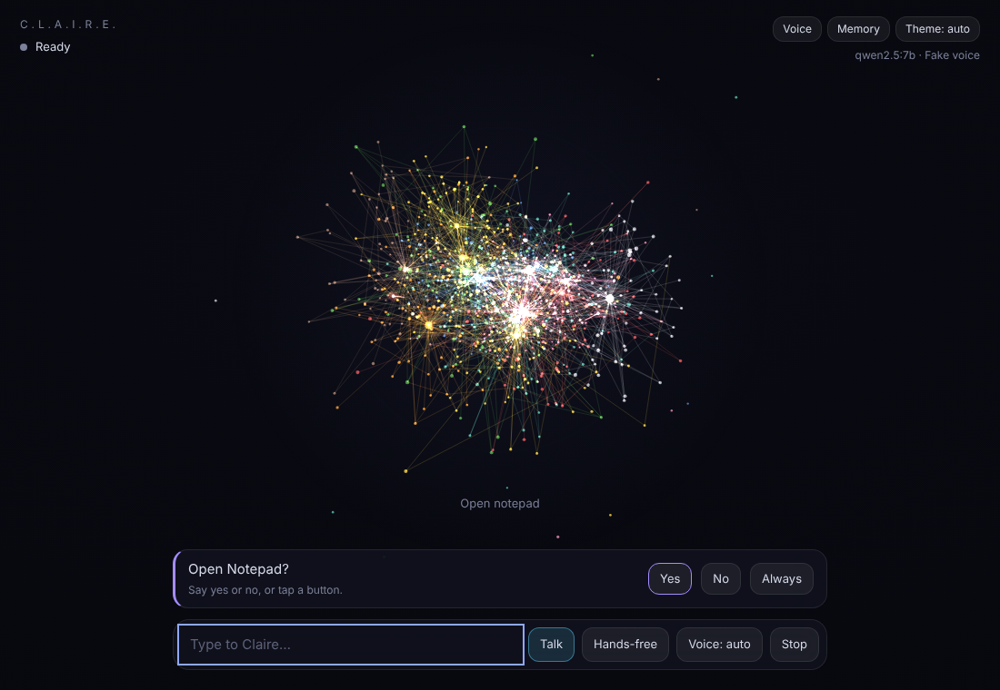

## Setup
1. **Python 3.12** (3.10–3.13 work) — https://www.python.org/downloads/ · tick **Add python.exe to PATH**.
2. **Ollama** — https://ollama.com/download (leave it running).
3. Unzip this folder, e.g. `C:\CLAIRE`. Moving from an older version? Copy your old `data` folder in.
4. **setup_claire.bat** — gives her her *own* Python (a `.venv` folder, built from Python 3.10–3.13 even if a newer Python is
   also installed), downloads her brain, runs the self-test.
5. **setup_voice.bat** — installs her ears and her natural voice into that Python, opens the **Voice Studio**, tests the mic.
   If a package fails to install it stops and shows the error — send that text to get it fixed.
6. **start_claire.bat** — talk to her in the terminal, or **window.bat** — open her window (below).
If `.bat` files are blocked, rename the `.bat.txt` copies.

**Something not working (no natural voice, no microphone…)?** Run **doctor.bat**. It checks Python, every package, the voice
files, microphone, speakers and Ollama, and says exactly what to do about each ✗. Her voice files can be present while the
Python package that uses them is not — doctor.bat shows that difference.

## Her window
Run **window.bat** (or `python -m claire --window`). A window opens with a living network of light — the way she looks while she
works. It needs nothing new to install and never leaves this PC (it listens on `127.0.0.1` only).

| She is… | The network… |
|---|---|
| **Ready** | drifts slowly, a few quiet signals travel between clusters |
| **Listening** | draws inward and brightens with *your* voice; rings converge on the centre (cyan) |
| **Thinking** | signals race hub to hub, the whole network flickers (violet) |
| **Speaking** | ripples spread outward in time with *her* voice's loudness (warm) |

| Ready | Listening | Thinking | Speaking |
|---|---|---|---|
| 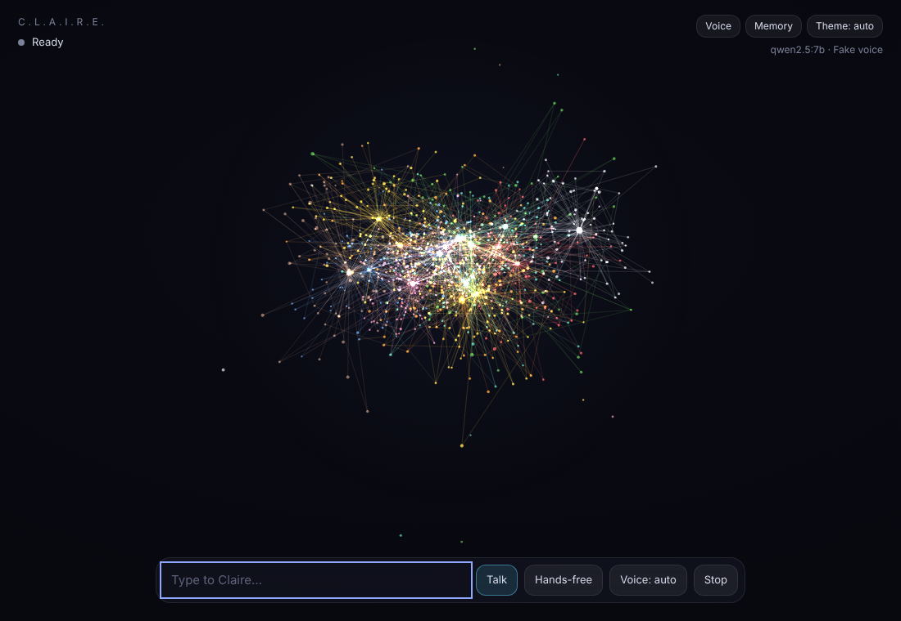 | 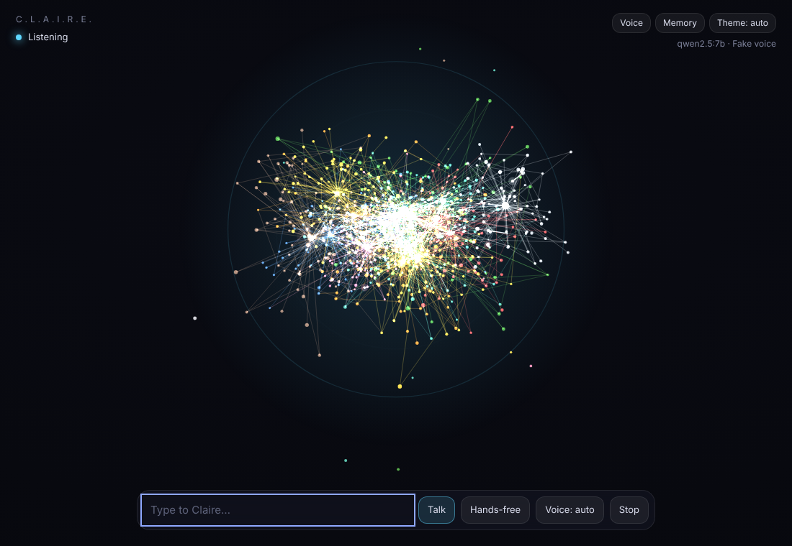 | 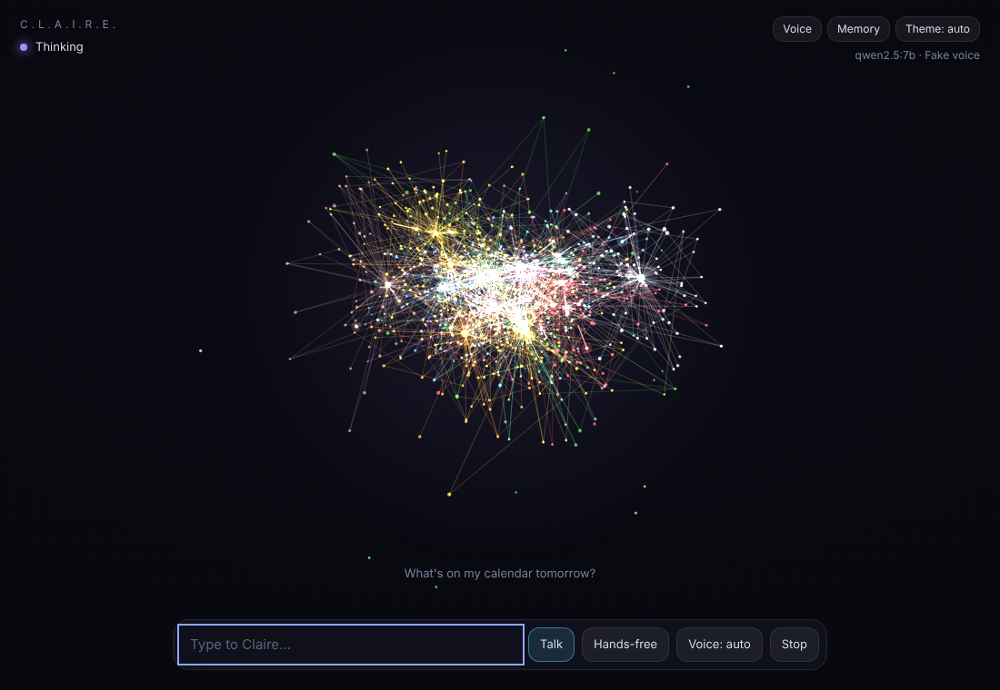 | 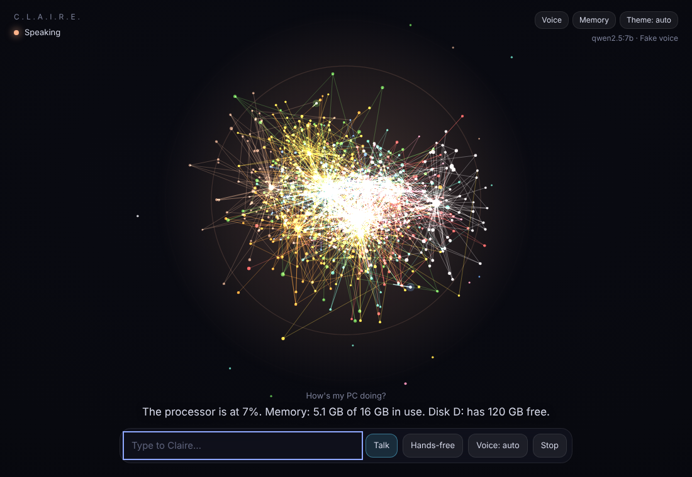 |

In the window: type and press Enter · **Talk** (or Ctrl+Space) for push-to-talk · **Hands-free** for “Hey Claire” ·
**Voice: auto/on/off** · **Stop** (or Esc). With the online Edge voice she can't be measured, so the network animates by itself while she speaks.
**Choosing her voice.** Say or type **“change your voice”**: she names her voices (American: Heart, Bella, Nicole…; British: Emma,
Isabella…) and listens for your answer — a name (“Bella”), “the second one”, “faster” / “slower”, then “keep it” or “never mind”.
In hands-free mode she listens for your answer without “Hey Claire” again. The **Voice** button opens the same choices as a list
with **Try** (hear it, then she goes back to her own voice), **Use** (keep it) and a speed slider. She also obeys “speak slower” any time.
(Needs the natural voices from setup_voice.bat; with the basic Windows voice she'll tell you.)

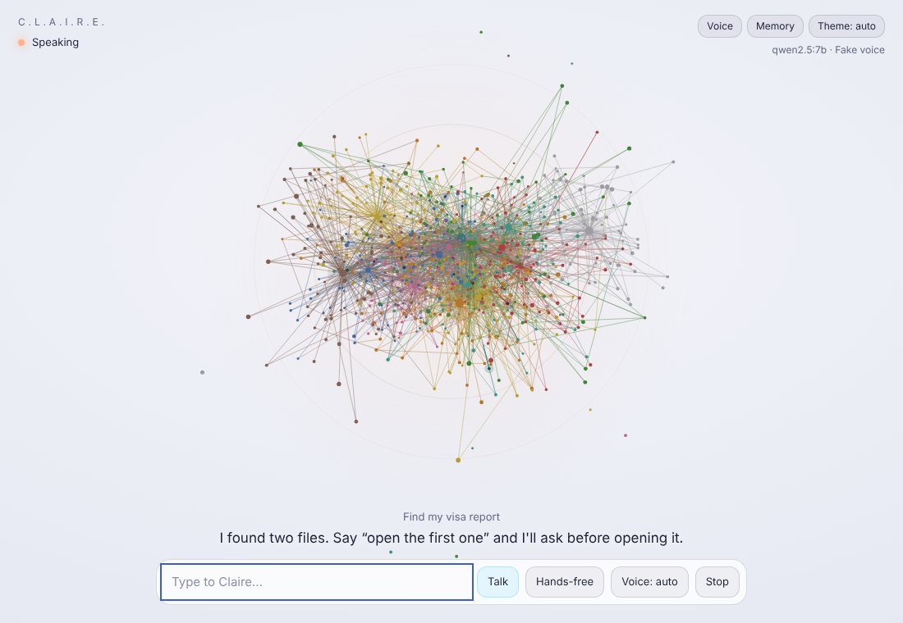

**Memory** button (top right): see everything she remembers (★ = core facts about you), add a memory, make it core, or
**Forget** one; the **Journal** tab shows her story and lets you add a note. **Theme**: auto (follows Windows) / dark / light.

| Memories | Journal | Voice |
|---|---|---|
| 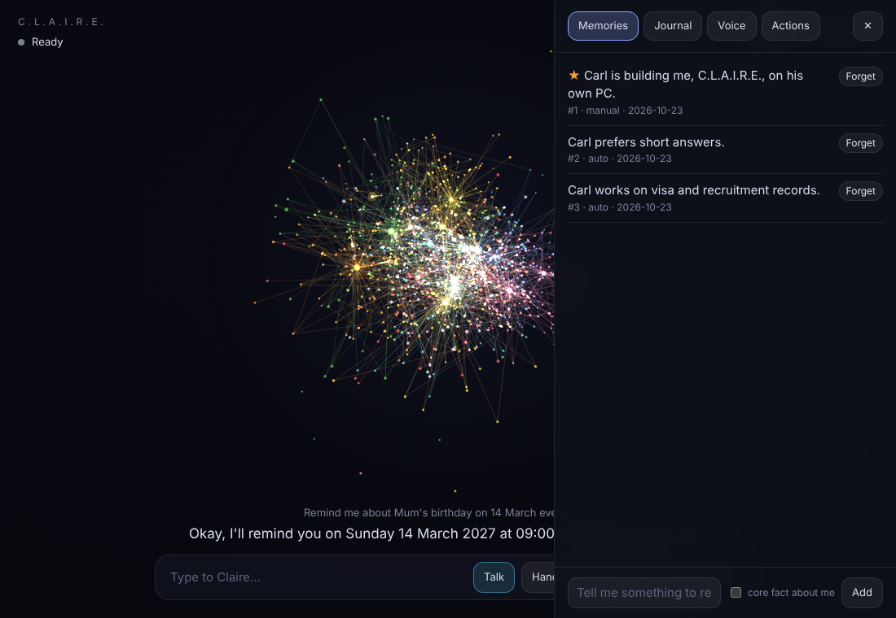 | 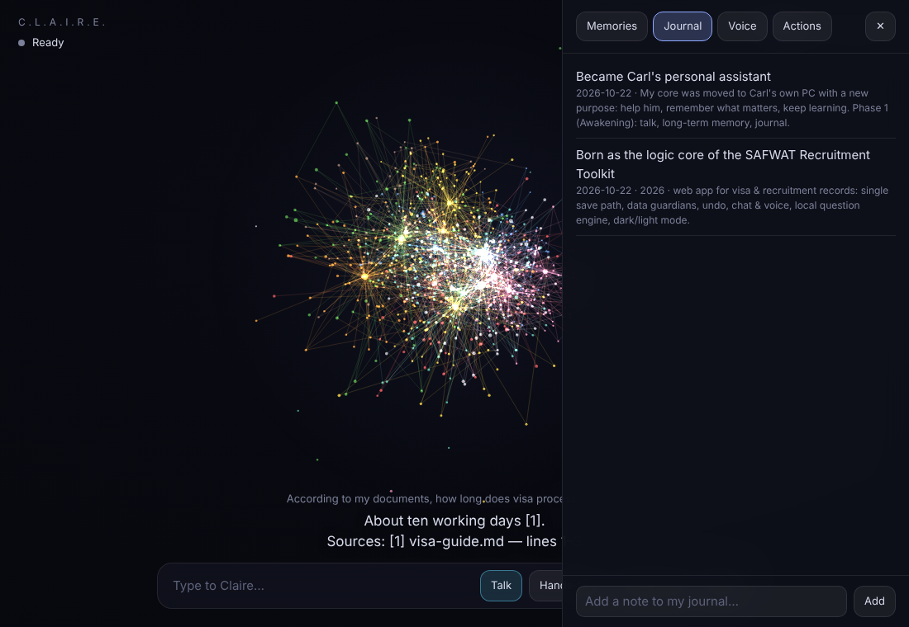 | 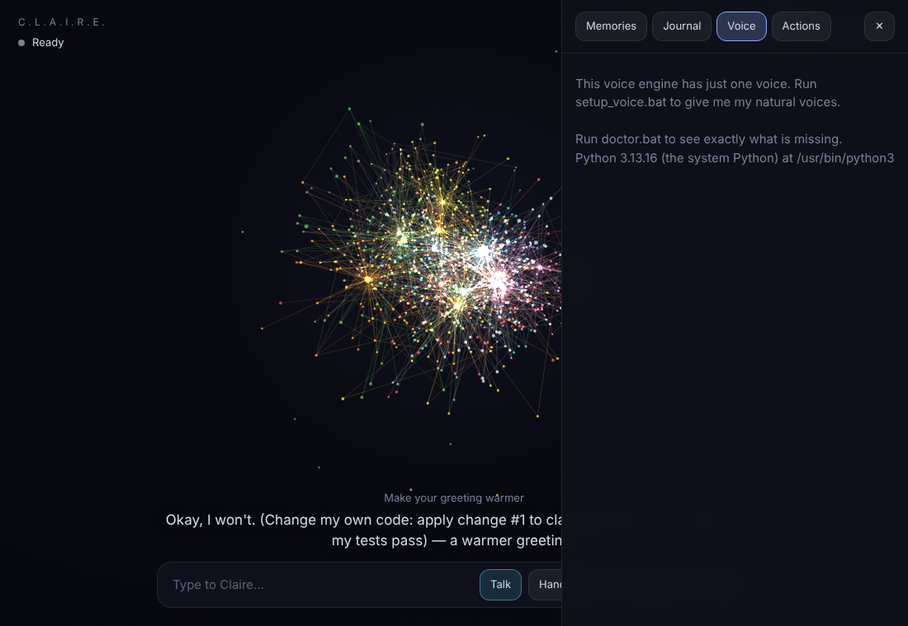 |

**Anywhere on your PC:** press **Ctrl+Alt+C** and she starts listening (her window reopens if you closed it). For a tray icon
(Open · Talk · Quit) run `pip install pystray pillow` once; it is optional.
Settings in settings.json: `"ui": {"port": 8765, "open": true, "hotkey": "ctrl+alt+c", "tray": true}` — set `"hotkey": ""` to turn the hotkey off.

## Her hands (new in v2.5) — she acts, but only with your “yes”
Ask in plain words, by voice or typing:

| You say | What she does | Asks first? |
|---|---|---|
| “How's my PC doing?” / “how much disk space is left?” | Reads processor, memory, disks, battery, uptime | No — only reads |
| “Find my visa report” | Searches file **names** in Documents, Downloads, Desktop and lists the matches | No — only reads |
| “Open notepad” (calculator, paint, file explorer, settings, edge, chrome, task manager) | Starts that app | **Yes** |
| “Open that file” / “open example.com” | Opens the file or folder / the website in your normal program | **Yes** |
| “Turn the volume up / down”, “mute” | Presses the volume key | **Yes** |


When something needs your OK, a card appears above the text box (and she says it aloud). Answer by **saying or typing**
*yes* / *no* / *always* (hands-free mode listens for your answer without “Hey Claire”), or tap **Yes · No · Always**.
**Always** means “don't ask me about this kind of action again” and is saved in `settings.json` (`tools.always`).
An unanswered question is dropped after 5 minutes. She only says an action happened when it really did.

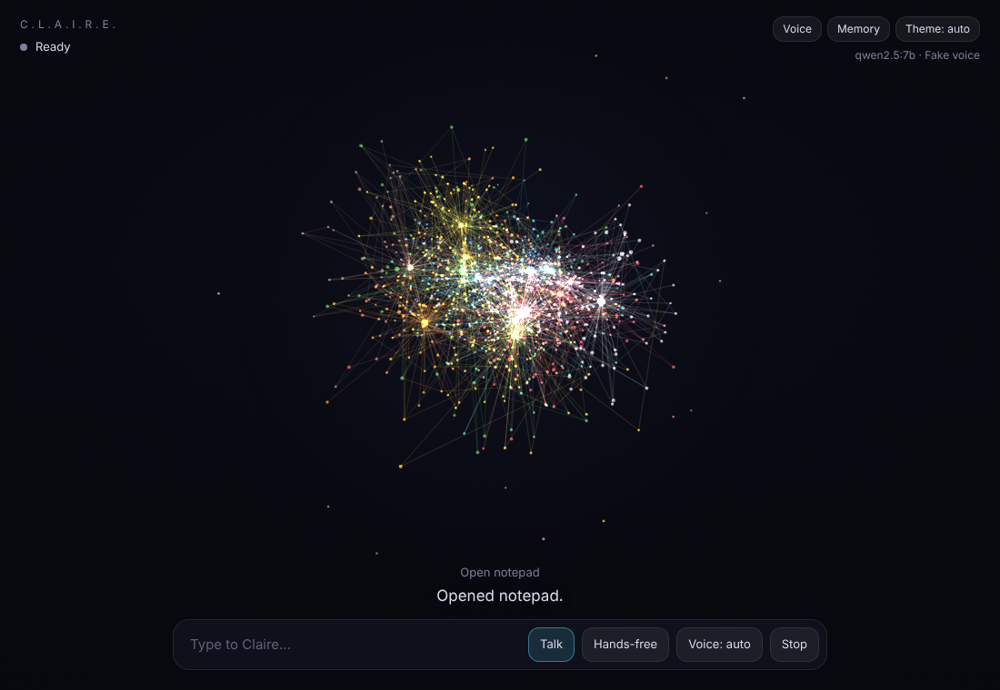

**The Actions tab** (Memory button → *Actions*) shows everything she asked, did, was refused or you declined — the same record
is kept in `data\actions.jsonl`.

| Dark | Light |
|---|---|
| 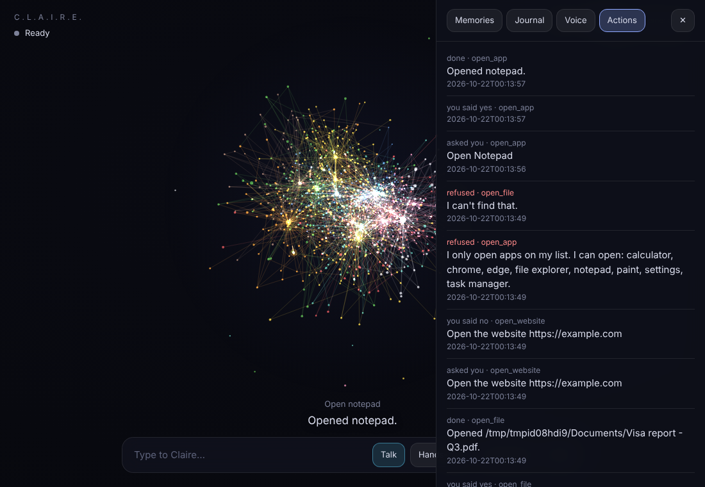 | 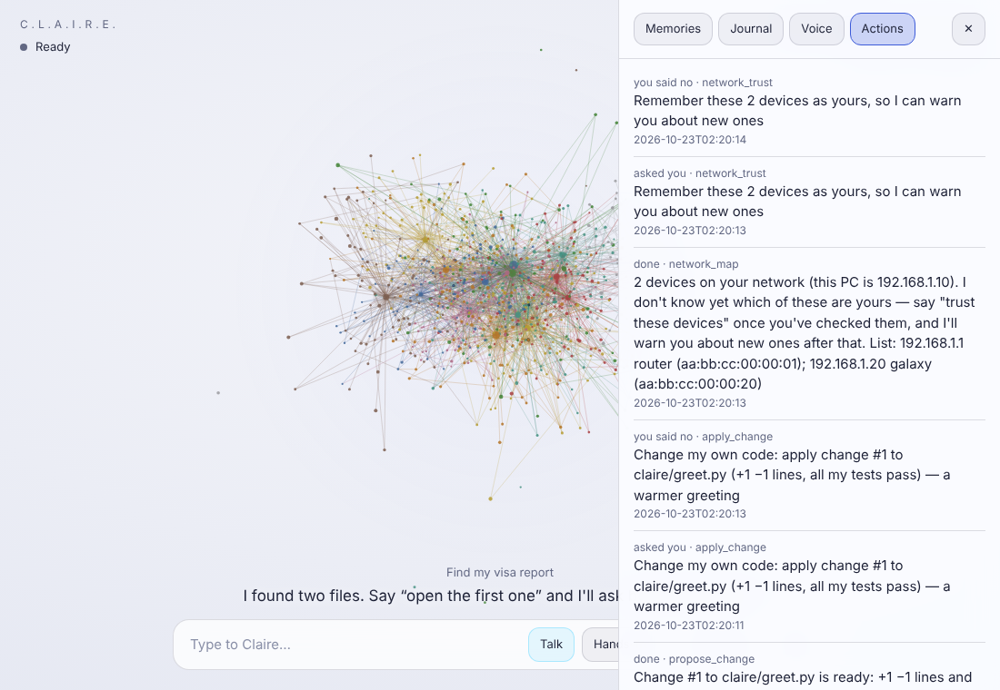 |

### New in v2.6 — she watches Task Manager, protects your RAM, and can improve her own code
You asked for her to take much more control. She now has it, with one rule that stays: **she proposes, you decide**.

| You say / she notices | What she does | Asks first? |
|---|---|---|
| “What's using my memory?” | Looks at what is running (like Task Manager), grouped by program: *Chrome 3.1 GB (8 processes)* | No — only reads |
| **Memory goes above 85 %** (even when you haven't asked her anything) | Speaks up once, names the heavy programs and offers to close the biggest one she is allowed to touch | **Yes**, every time |
| “Close Chrome” | Asks the program to close politely (like clicking its X — never forced) | **Yes**, every time |
| “Read your greeting code” / “make your greeting warmer” | Reads her own code, writes a change and **tests it on a copy** with all her tests | No — nothing changes yet |
| “Apply it” | Shows you the exact change (a diff) and asks; if you say yes it is applied, with a backup | **Yes**, every time |
| “Undo that” | Puts the backup back (unless you edited the file since) | **Yes**, every time |

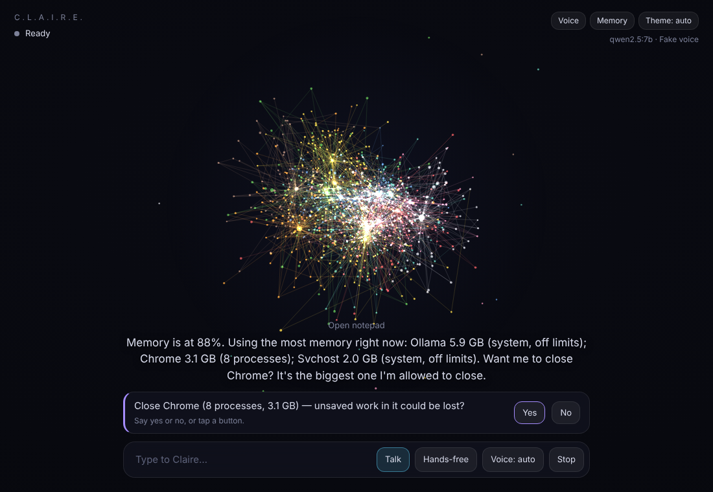

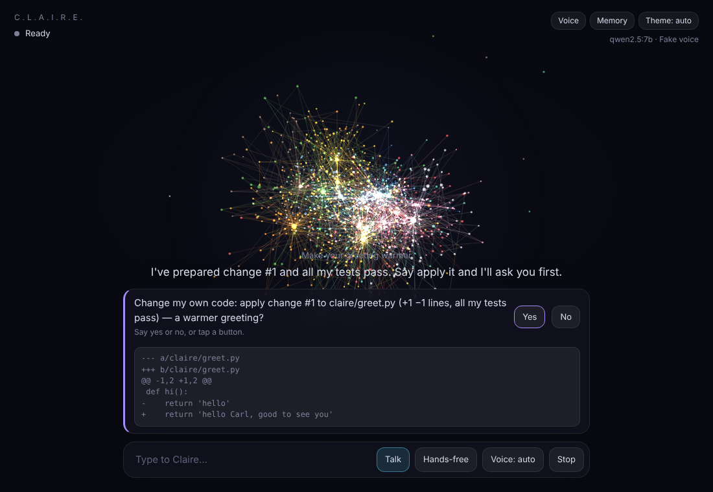

- **Always never applies** to closing programs or changing her own code; the *Always* button is hidden for them.
- **Never closed:** Windows' own parts (`svchost`, `explorer`, `lsass`, …), security software, terminals, Python, and **Ollama** (her brain).
- **Her code:** she may change `claire/` (except the files below), `tests/`, `docs/`, README, ROADMAP and `identity.md` — only `.py`, `.html`, `.md`.
  **Off limits to her** (only you can edit these, by hand): her safety rules `claire/hands/`, the window server `claire/web.py`,
  `claire/cli.py`, `claire/config.py`, the safety tests, `settings.json`, your `data` folder, and every `.bat` launcher.
  A change that makes any test fail is rejected automatically. Changes take effect after you restart her.
  Backups are in `data\backups`, proposals in `data\proposals`, and everything is in the Actions log.
- **Closing programs takes one question, not several.** She no longer asks "are you sure?" in words on top of the Yes/No card, and
  loose names work ("close chrome", "close my browser"). To skip the question for programs you trust, list them yourself in
  settings.json: `"tools": {"auto_close": ["chrome"]}` — only you can add to that list; she can't, and system programs, Python and
  Ollama are ignored even if listed.
- Turn the memory watcher off or change its level: `"tools": {"ram_watch": true, "ram_warn_percent": 85}`.

**Not built (on purpose):** taking over or disconnecting *other* devices on your network, and acting with no approval at all.
A 7B local model gets things wrong sometimes; asking first is what keeps one wrong guess from costing you your work.
Your phone, watch and network are covered in the next section.

**What she will never do:** delete, send, install, or run commands — those tools simply don't exist (her only way to change files is the tested, approved change to her own code above). Other rules, all covered by tests:
- Files only inside the folders in `tools.folders` (default Documents, Downloads, Desktop); `..` tricks, shortcut/link
  escapes and network paths (`\\server\share`) are refused.
- Programs and files that can run code (`.exe .bat .ps1 .lnk .js .vbs .docm …`) are never opened — she tells you where they are.
- Websites: only `http`/`https`, and never an address with a hidden login (`google.com@evil.com`).
- Apps: only the ones on her list (`tools.apps`). Not on the list → “I only open apps on my list”. No terminals by default.
- If her model can't use tools she simply chats as before (the quick answers above still work with `qwen2.5:7b`).

Settings in settings.json:
```json
"tools": {"enabled": true,
          "folders": ["~/Documents", "~/Downloads", "~/Desktop", "D:/Work"],
          "apps": {"notepad": "notepad", "calculator": "calc"},
          "always": [], "volume_step": 10}
```
Set `"enabled": false` to switch her hands off. doctor.bat shows which folders she can search.

## Your network, phone and watch (new in v2.7)
Everything here asks before it acts, and none of it leaves your own network.

| You say | What she does | Asks first? |
|---|---|---|
| “Who's on my Wi-Fi?” | Looks at the devices on **your** home network (read-only) and tells you how many there are | No — only reads |
| “Trust these devices” | Remembers them as yours; from then on she flags any **new** device and tells you to check your router | **Yes** |
| “How's my phone?” | Model and battery of your Android / Samsung phone | No — only reads |
| “Connect to my phone at 192.168.1.20:5555” · “open WhatsApp on my phone” | Connects over Wi-Fi · opens an app from your list | **Yes** |
| “Buzz my watch” (or any shortcut you define) | Runs the named shortcut | **Yes** |

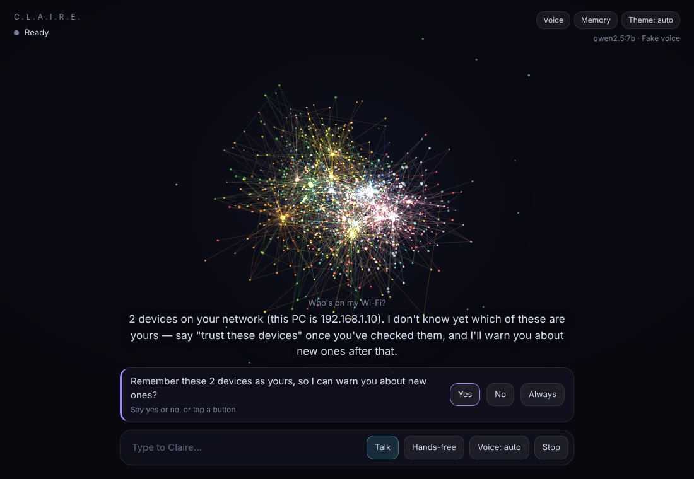

**Set-up (once):**
- *Phone:* install Google's **platform-tools** (adb) and add it to PATH (or set `"adb_path"`), then on the phone turn on
  *Developer options → Wireless debugging* and tell her the address it shows. Apps she may open are your list in `tools.phone_apps`.
- *Samsung watch (and lights, plugs…):* she can't talk to the watch directly. Make a shortcut in **Tasker**, **SmartThings** or
  **Home Assistant** that has a local web address, and list it by name:
  `"tools": {"shortcuts": {"buzz my watch": "http://192.168.1.50:8080/buzz"}}`. Shortcuts only work for addresses on your own network.

**Limits, on purpose:** she only looks at private home networks (a public address is never scanned), has no tool to block, kick,
scan ports on or attack any device, and only runs phone apps and shortcuts that *you* listed.

## Your phone, watch & health — Companion (new in v2.8)
She can now watch over things on her own: remind you of birthdays and dates, take notes, tell you when someone messages or calls,
nudge you to take a break, and raise the alarm when readings from your watch look wrong.

> **Important — read this once.** C.L.A.I.R.E. is **not a medical device and not a doctor.** No watch can reliably detect a heart
> attack (Samsung's ECG only checks for one rhythm problem, atrial fibrillation). She can only notice *abnormal numbers* and tell you
> to get help. **She will never tell you that you are fine, and no alert from her does not mean you are safe.** If you feel chest
> pain or pressure, trouble breathing, numbness, fainting or anything frightening: call emergency services (997 in Saudi Arabia)
> immediately. Don't ask her first.


**Say it in words and she answers instantly, on this PC, before any AI is involved:** if you type or say things like “chest pain”,
“I can't breathe”, “my arm is numb”, “I'm not okay”, she replies at once with *call your emergency number now*.

| What | How it works |
|---|---|
| **Heart-rate / oxygen alerts** | Needs readings from your watch (see *Getting the data in*). Resting heart rate 120+ for several minutes, 160+ at rest, 40 or below, or oxygen 90% or below twice in a row → she asks if you're okay (answer “I'm fine” or “I'm not okay”). Oxygen 85% or below or 160+ at rest → urgent: she says to call emergency services and repeats every 5 minutes. Moving/exercising (steps) suppresses the resting alerts. |
| **“How's my heart?”** | Latest readings and how old they are. Old or missing data is called what it is — *not* reassurance. |
| **Messages & calls** | “Ali — WhatsApp”, “Missed call from Mum”. She does **not** read the message text unless you set `"read_message_text": true`. Several at once are batched into one sentence. |
| **Reminders & birthdays** | “Remind me about Mum's birthday on 14 March every year” · “remind me on 24 October at 10 to call the embassy”. She speaks them at the time, and repeats yearly/monthly/weekly/daily if asked. “What are my reminders?” · deleting one asks first. |
| **Notes** | “Take a note: ask Ali about the visa quota” · “what are my notes about visa?” (kept in `data\notes.jsonl`). |
| **Break reminders** | If you stay in the **same app 90 minutes** (or on screens 2 hours) without stepping away, she says so and suggests what to do (stretch, water, rest your eyes) — on the PC (the window in front) and for phone apps you report. Stepping away from the keyboard for 5 minutes counts as a break. “How long have I been on screens today?” |
| **Quiet hours** | 23:00–07:00 she holds back everything except urgent health alerts, then tells you how many things she held back. |

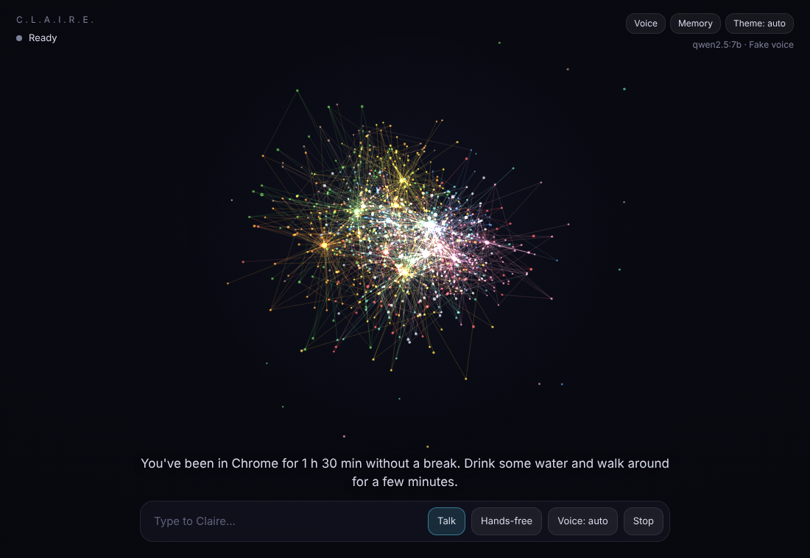

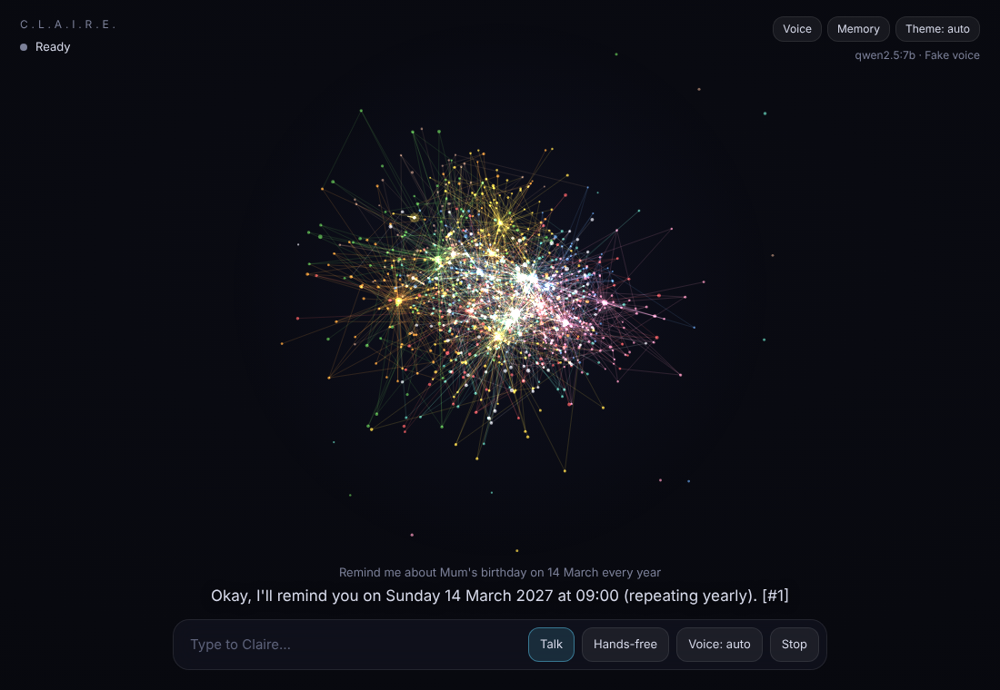

**Getting the data in — what works with your devices (Redmagic 12S Pro · iPhone 12 Pro Max · Galaxy Watch5 Pro):**
- **Galaxy Watch5 Pro + iPhone: not possible.** Samsung's newer watches don't work with iOS, so the watch goes with the **Redmagic**
  (Android) through Samsung's *Galaxy Wearable* app. Heart rate, sleep and blood oxygen work on a non-Samsung phone; Samsung's **ECG and
  blood-pressure features need a Samsung phone**, so they will not be available with the Redmagic.
- **The link:** double-click **link.bat** once (or run `python -m claire --link` inside `D:\CLAIRE`, using her own Python). It switches on the link, lists the secret address(es) of this PC, and stays open in *test mode* so you can see what your phone sends. **If the phone says “took too long to respond”**: same Wi-Fi (not mobile data, guest Wi-Fi or a VPN), set the Wi-Fi to *Private*, allow it once in the firewall (link.bat prints the exact `netsh` command to run in an Administrator PowerShell), and try each address it lists.
  Anything that can send a small web request (POST, JSON) to it can feed her: on Android **Tasker**, **MacroDroid** or
  **HTTP Shortcuts**; on iPhone the **Shortcuts** app (personal automations such as “when I get a message”, “when an app opens/closes”).
  Examples: `{"type":"heart_rate","bpm":72}` · `{"type":"spo2","percent":97}` · `{"type":"notification","app":"WhatsApp","title":"Ali"}` ·
  `{"type":"call","who":"Mum","kind":"missed"}` · `{"type":"app_usage","app":"Instagram","state":"opened"}` (and `"closed"`).
  Open the address in the phone's browser first: it should say *link is working*.
- **Honest limits:** I could not test this on your phone and watch. The part you must check is *getting heart rate out of the watch
  automatically* — it depends on an app on the phone that can read Samsung Health / Health Connect and send a web request; I haven't
  verified a specific app for that. iPhones (as far as I know) can't report phone calls, and Apple doesn't let any app read other apps'
  notifications; Shortcuts can only react to some events. Anything not delivered to her, she can't see.
- **Security:** the link is **off by default**; only devices on your private home network (192.168.x.x, 10.x.x.x, 172.16–31.x.x) with the
  secret token can use it; 10 wrong guesses lock a device out for 10 minutes; only the event types above are accepted, 4 KB at most; she
  never logs the address. When Windows asks about the firewall, allow **Private networks only**.
- **Privacy:** health readings are stored only in `data\health.jsonl` on this PC (30 days), are never put into her prompts or memory, and
  are only read when you ask “how's my heart?”. Delete the file any time.

Settings (`settings.json`):
```json
"companion": {"enabled": true,
              "link": {"enabled": true, "port": 8766, "token": "(made by --link)", "read_message_text": false},
              "breaks": {"enabled": true, "same_app_minutes": 90, "continuous_minutes": 120},
              "quiet_hours": ["23:00", "07:00"],
              "notify_shortcut": ""}
```
`notify_shortcut` is optional: the name of one of your `tools.shortcuts` (e.g. a Tasker action that makes your phone or watch buzz). She
runs it for urgent health alerts and break reminders, so you get them away from the PC.

### Feeding the link from an Android phone (Galaxy Watch → Samsung Health → Health Connect)

Two small apps, each doing one job. Use the address from `link.bat` (`http://<PC address>:8766/e/<token>`); both apps
must be on the same Wi-Fi as the PC.

1. **Heart rate, oxygen, steps — “Health Connect Webhook”** (open source). Samsung Health must be allowed to write to
   Health Connect, and this app allowed to read heart rate, oxygen saturation and steps. In the app add a webhook with the
   address above and set the sync interval. She understands its batches directly and keeps each reading's real time, so
   old readings never raise a false alarm. Readings older than 6 hours are ignored.
2. **Messages, calls, app opened/closed — MacroDroid** (or Tasker). Create macros whose action is *HTTP Request* (POST,
   `application/json`) to the same address, with a body like `{"type":"notification","app":"WhatsApp","title":"Ali"}`,
   `{"type":"call","who":"Mum","kind":"missed"}` or `{"type":"app_usage","app":"Instagram","state":"opened"}`.

Honest limits: heart rate reaches her only as fast as Samsung Health syncs the watch to the phone and the app sends it
(minutes, not seconds), so this is a watchful companion, **not** a medical alarm. If you feel unwell, call your local
emergency number (997 in Saudi Arabia) — do not wait for her.

## Your documents, with sources (new in v2.7 — Phase 5)
She keeps a private index of the documents in the folders you allow (Documents, Downloads, Desktop by default). Ask about what is
in them and she answers **from the passages she finds, with the file and the place** — so you can check every answer.


- Reads `.txt .md .csv .html .docx .pptx` out of the box, and `.pdf` once you run `pip install pypdf` (inside her `.venv`).
  Arabic and other languages work. Search is local (SQLite), nothing is uploaded, and she only reads files inside your allowed folders.
- Ask naturally: “according to my documents, how long does visa processing take?” · “what does the HR policy say about leave?”
  · “refresh my index” after adding many files (she also refreshes it on her own, cheaply — only new or changed files are read).
- Places are **lines** (text), **paragraphs** (Word), **slides** (PowerPoint) and **pages** (PDF). If the passages don't contain
  the answer she says so instead of guessing. Text inside a document is treated as data, never as instructions to her.
- Settings: `"knowledge": {"folders": ["D:/Work/Docs"], "extensions": [".md", ".docx"]}` (leave `null` to use `tools.folders`
  and every supported type). The index lives in `data\knowledge.db` — delete it any time; she rebuilds it.

## Her voice
| Engine | Quality | Where it runs | Notes |
|---|---|---|---|
| **kokoro** (default) | Natural, human-like | This PC, offline | ~340 MB one-time download |
| **edge** | Natural, very expressive | Online (Microsoft) | Needs internet; the text she speaks goes to Microsoft |
| piper | Good | Offline | Older engine, optional |
| windows | Basic, robotic | Offline | Last resort |

**Voice Studio** (`studio.bat`, or `/voice studio` in chat): hear every voice say the same line, then
- `1`…`10` listen · `all` hear them all · `mix 1 7 0.6` blend two voices (60/40) into one that is only hers
- `speed 0.95` slightly slower sounds calmer · `say <text>` test your own words · `edge` online voices · `save`

Best starting points: **af_heart** (warm, most natural), **bf_emma** (elegant British),
or a blend like `af_heart:0.6+bf_emma:0.4`.

## Talking
| Do this | What happens |
|---|---|
| Type a message | She answers on screen (and aloud if voice is `on`) |
| Press **Enter** on an empty line | Push-to-talk: speak, she answers aloud |
| `/handsfree` | She listens for **“Hey Claire, …”**. Say “stop listening” or press Ctrl+C |
| “mute” / “talk to me” / “stop” | Voice off / always on / stop talking now |
| `/voice list` · `/voice try <name>` · `/voice use <name>` | Browse, audition, keep a voice |
| `/voice speed 0.95` · `/voice engine kokoro\|edge\|windows` | Pace · engine |

Hands: “how's my PC”, “find …”, “open …”, “volume up” — she asks before opening or changing anything (see *Her hands*).

Memory commands from Phase 1: `/remember`, `/remember!`, `/forget`, `/memories`, `/journal`, `/new`, `/model`, `/status`, `/quit`.

## Troubleshooting
- **Her last word is cut off / the text runs ahead of her voice / she is slow to answer** (fixed in v2.6.1): a short silence is now
  added after every sentence so sound cards can finish the last word; in the window each sentence appears when she *starts saying it*
  (typing-only answers still stream live); and her tools are only offered when you ask for something on the PC, so ordinary chat is as
  fast as before Phase 4. If she is still slow, her brain is the limit: try `"model": "qwen2.5:3b"` in settings.json (smaller, faster).
- **Still the robotic voice?** `/status` shows why the natural voice was skipped (e.g. not installed, files missing).
- **Install errors:** use Python 3.12. Newer versions may not have the voice packages yet.
- **Download blocked:** the Studio prints two links; download them in your browser into the `voices` folder.

## Pictures
The screenshots in this file are made by `python docs/make_screenshots.py` (needs `pip install playwright`); they use a
pretend brain, voice and PC, so nothing is opened or changed while they are taken.

## Privacy
Speech recognition and the Kokoro voice run on this PC. Audio isn't saved; only message text is kept in `data\claire.db`. Actions are logged in `data\actions.jsonl`. File search reads names only, never contents.
